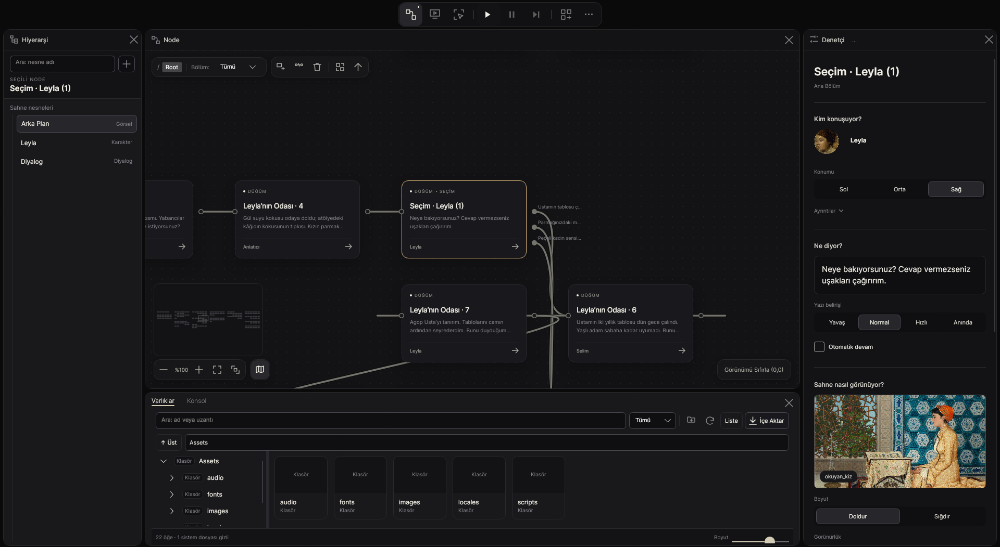
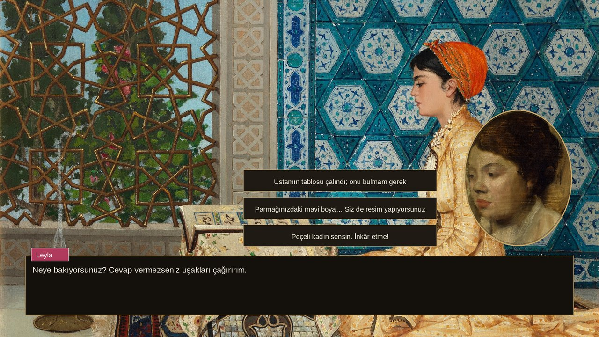
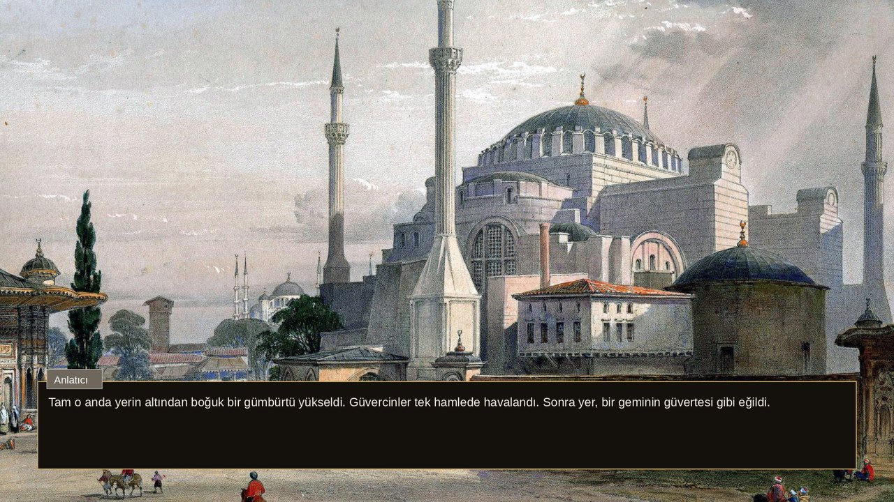
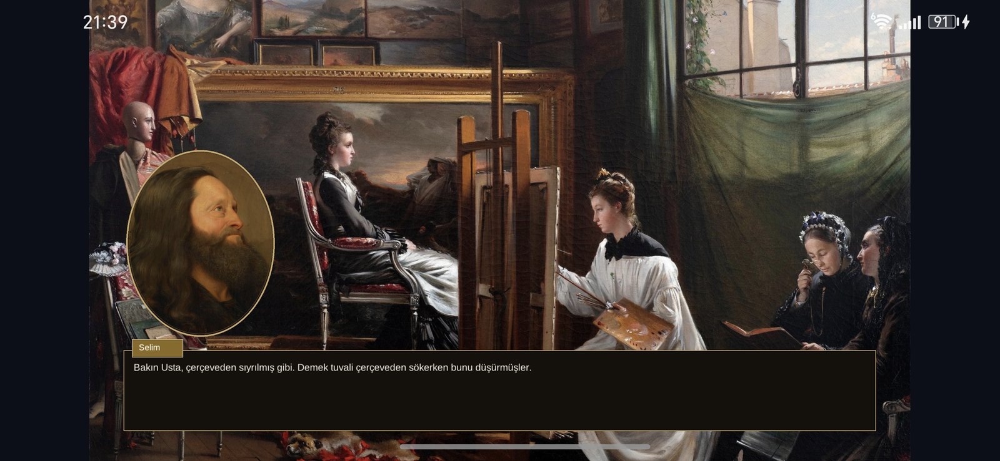
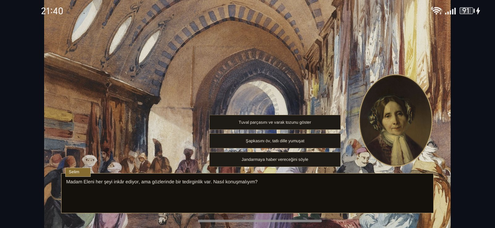
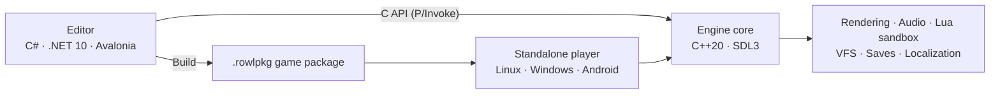

<div align="center">

# Rowl Engine

**A visual novel engine and node-based editor for people who want to make story games — with or without writing code.**

[](https://github.com/omerseyfettinozd/Rowl-Engine/actions/workflows/ci.yml)
[](LICENSE)


[Features](#features) ·
[Demo](#demo-kayıp-tablo-the-lost-painting) ·
[Getting started](#getting-started) ·
[Platforms](#platforms) ·
[Scripting](#scripting-with-lua) ·
[Roadmap](#roadmap) ·
[Documentation](#documentation) ·
[Türkçe](README.tr.md)

<br>



<sub><i>The editor with “Kayıp Tablo”, the bundled demo: a choice node on the canvas, the inspector with the speaker and a live scene preview.</i></sub>

</div>

---

## What is Rowl Engine?

Rowl Engine is a game engine for **visual novels** — story-driven games where the player's choices change where the story goes.

You build the story by connecting **nodes** on a canvas. Each node is a scene: who is on screen, what they say, which music plays, which choices the player gets. Choices branch the story into different paths and endings. When the game is ready, you export it as a standalone game that runs without the editor.

It is made for people who **don't know how to code**, while still leaving the door open: anything the built-in nodes can't do can be added with **Lua** scripts.

## Features

<table>
<tr>
<td width="50%" valign="top">

### Story editor
- Node-based story canvas with branching choices and multiple endings
- Variables and conditions: the game remembers the player's choices
- Chapters, node groups and a reusable node library
- Play the game inside the editor instantly, no build step
- Undo/redo, autosave and crash recovery
- Editor interface in English and Turkish

</td>
<td width="50%" valign="top">

### Presentation
- Characters with expressions, layers, speaker highlight and lip sync
- Backgrounds, camera moves and scene transitions (dissolve, push, iris)
- Music, sound effects, voice and ambience on a mixer
- Typewriter text with rich-text markup
- Multi-language games with a built-in translation workflow
- Unicode text everywhere — Turkish, accents, right-to-left

</td>
</tr>
<tr>
<td width="50%" valign="top">

### Ready-made player features
- Save, load and rewind in every game, out of the box
- Each game keeps its own saves and player settings
- Read-text tracking for skip and backlog features
- Simple modding: files in a `mods/` folder override game assets

</td>
<td width="50%" valign="top">

### Built to be safe
- Lua scripts run in a sandbox: no file, OS or network access
- Instruction, time and memory limits stop runaway scripts
- Atomic saves — an interrupted save never corrupts the old one
- Integrity-checked game packages (`.rowlpkg` with SHA-256 manifest)

</td>
</tr>
</table>

## Demo: *Kayıp Tablo* (The Lost Painting)

A ten-minute branching story that ships in [`samples/kayip_tablo`](samples/kayip_tablo). İstanbul, July 1894: an old master's painting vanishes three days before an exhibition, and his apprentice searches the Grand Bazaar, a collector's mansion and a scholar's study for it — until the great earthquake of 10 July 1894 strikes. 184 nodes, variables, conditional choices, a Lua script and four endings.

Every image is a public-domain painting (Aivazovsky, Osman Hamdi Bey, Degas and others) and every track is CC0 or public domain; see [`samples/kayip_tablo/CREDITS.md`](samples/kayip_tablo/CREDITS.md).

<table>
<tr>
<td width="50%"></td>
<td width="50%"></td>
</tr>
<tr>
<td align="center"><sub>Choices shape whether Leyla trusts you</sub></td>
<td align="center"><sub>10 July 1894, noon — the earthquake</sub></td>
</tr>
</table>

## Running on Android

The same demo, exported as an APK and played on a real Android phone — touch input, audio and Turkish text included.

<table>
<tr>
<td width="50%"></td>
<td width="50%"></td>
</tr>
<tr>
<td align="center"><sub>Master Agop's studio</sub></td>
<td align="center"><sub>Madam Eleni in the Grand Bazaar</sub></td>
</tr>
</table>

## Getting started

### Requirements

| | |
| --- | --- |
| Build tools | CMake 3.25+, Ninja, a C++20 compiler (GCC, Clang or MSVC) |
| Engine libraries | SDL3, Lua 5.4 or 5.5, zstd, libogg + libvorbis (FreeType/HarfBuzz/FriBidi/libunibreak optional, for advanced text shaping) |
| Editor | .NET 10 SDK |

On Ubuntu 24.04 most of these come from `apt` (SDL3 is built from its release tarball); the exact package lists the CI uses are in [`docs/CI_DEPENDENCIES.md`](docs/CI_DEPENDENCIES.md).

### Build and run

```bash
git clone https://github.com/omerseyfettinozd/Rowl-Engine.git
cd Rowl-Engine

# Engine, standalone player and native tests
cmake -S . -B build -G Ninja -DCMAKE_BUILD_TYPE=Debug
cmake --build build --parallel

# Editor (loads the engine library built above)
dotnet run --project editor/RowlEngine.Editor.csproj
```

### Run the tests

```bash
ctest --test-dir build --output-on-failure
```

The suite covers the native engine, the C API contract, packaging and the editor (over a thousand editor tests run headless).

### Export a game

From the editor, **Export** (shortcut: *Build game*) produces a standalone game folder: the player, the engine library and the packed game (`Assets/packages/game.rowlpkg`), plus `run_game.sh` / `run_game.bat` launchers. The same layout can be shipped as a portable ZIP or, on Linux, a single self-extracting installer (`tools/export_game.py`).

For Android, see [Platforms](#platforms).

## Platforms

| Platform | Editor | Exported games | Status |
| --- | :---: | :---: | --- |
| **Linux** x86_64 | ✅ | ✅ | Tested on real screens (Wayland, XWayland) |
| **Windows** x64 | ✅ | ✅ | Built, tested and packaged in CI |
| **Android** arm64 | — | 🧪 | Experimental APK, runs on a real phone |
| **macOS** arm64 | 🛠️ | 🛠️ | Compiles in CI; packaging in progress |
| **Linux** arm64 | — | 🛠️ | Engine compiles in CI |
| **iOS** | — | 🛠️ | Planned |

<sub>✅ working · 🧪 experimental · 🛠️ in progress · — not yet</sub>

The engine is plain C++20 on top of SDL3, so the same code targets **x86_64 and ARM64** on desktop and mobile. A platform is only called supported after a real package has run on a real device — see [`docs/PLATFORM_SUPPORT.md`](docs/PLATFORM_SUPPORT.md).

<details>
<summary><b>Building the Android APK</b></summary>

<br>

Requires the Android SDK with an NDK (the scripts look in `~/Android/Sdk`). No Gradle is needed.

```bash
packaging/android/build_deps.sh                          # SDL3, zstd, Lua, Ogg/Vorbis for arm64
packaging/android/build_apk.sh --project "path/to/MyGame" # → build/android-apk/RowlGame-arm64-v8a.apk
adb install -r build/android-apk/RowlGame-arm64-v8a.apk
```

The APK is debug-signed and meant for testing.

</details>

## Scripting with Lua

A node can run a Lua script when it becomes active, and choices can be gated by Lua conditions. Scripts read and write the story's variables:

```lua
-- Runs when this node is shown
local courage = tonumber(rowl.var_get("courage")) or 0
rowl.var_set("courage", courage + 1)
```

```lua
-- Condition on a choice: only offered when the player was brave enough
courage >= 2
```

Scripts run inside a sandbox with the standard `math`, `string` and `table` libraries only, and with hard limits (10 million instructions, 5 seconds per call, 64 MB of memory) so a broken or malicious script can't hang the game or touch the player's computer.

## Architecture



The editor and the exported game run the **same engine**: what you preview is what the player gets. The editor talks to the engine through a versioned, additive C API (`engine/include/rowl/c_api.h`).

## Roadmap

- **Player menus** — title screen, load screen, auto-advance and skip, language settings
- **Extras** — gallery, music room and achievements
- **Editor on phones and tablets** — the mobile layout is already designed
- **Beginner tutorials and starter templates**
- **Point-and-click tools** — clickable scenes for exploration and puzzle games
- **Visual scripting** — snap blocks together, Scratch-style, instead of writing Lua
- **AI assistant in the editor** — ask questions or have it build scenes for you
- **Better modding tools** for fans of games made with Rowl Engine
- **iOS and macOS packages**, tested on real devices

## Documentation

| Guide | |
| --- | --- |
| [Author guide](docs/AUTHOR_GUIDE.md) | Making a game in the editor |
| [Player guide](docs/PLAYER_GUIDE.md) | Running and shipping the standalone player |
| [Platform support](docs/PLATFORM_SUPPORT.md) | What runs where, and how it is verified |
| [Data formats](docs/DATA_FORMATS_AND_MIGRATION.md) | Project, save, profile and package formats |
| [Localization](docs/LOCALIZATION_CONTRACT.md) | Translating games and the editor |

## Contributing

Issues and pull requests are welcome. Before opening a pull request, please build the project and run the test suite (`ctest --test-dir build --output-on-failure`).

## License

Rowl Engine is released under the [MIT License](LICENSE). Third-party components and their licenses are listed in [`THIRD_PARTY_LICENSES.md`](THIRD_PARTY_LICENSES.md).

<div align="center">
<br>
Made by <a href="https://github.com/omerseyfettinozd">Ömer Seyfettin Özdemir</a>
</div>
