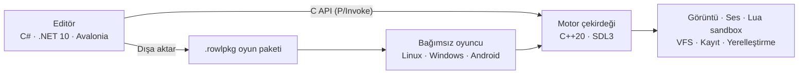

<div align="center">

# Rowl Engine

**Kodlama bilsin bilmesin, hikâye oyunu yapmak isteyen herkes için görsel roman motoru ve düğüm tabanlı editör.**

[](https://github.com/omerseyfettinozd/Rowl-Engine/actions/workflows/ci.yml)
[](LICENSE)


[Özellikler](#özellikler) ·
[Demo](#demo-kayıp-tablo) ·
[Başlarken](#başlarken) ·
[Platformlar](#platformlar) ·
[Lua](#lua-ile-betik-yazma) ·
[Yol haritası](#yol-haritası) ·
[Belgeler](#belgeler) ·
[English](README.md)

<br>


<sub><i>Editörde birlikte gelen “Kayıp Tablo” demosu: tuvalde bir seçim düğümü, sağda konuşmacı ve canlı sahne önizlemesiyle Denetçi.</i></sub>

</div>

---

## Rowl Engine nedir?

Rowl Engine, **görsel roman** yapmak için bir oyun motorudur: hikâye odaklı, oyuncunun seçimleriyle yön değiştiren oyunlar.

Hikâye, tuvalde **düğümler** birbirine bağlanarak kurulur. Her düğüm bir sahnedir: ekranda kim var, ne söylüyor, hangi müzik çalıyor, oyuncuya hangi seçenekler sunuluyor. Seçimler hikâyeyi farklı yollara ve sonlara ayırır. Oyun hazır olunca editör olmadan çalışan bağımsız bir oyun olarak dışa aktarılır.

Hedef kitlesi **kodlama bilmeden oyun yapmak isteyenlerdir**. Kod bilenler için kapı yine açık: hazır düğümlerin yapamadığı her şey **Lua** betikleriyle eklenebilir.

## Özellikler

<table>
<tr>
<td width="50%" valign="top">

### Hikâye editörü
- Dallanan seçimler ve birden fazla sonla düğüm tabanlı hikâye tuvali
- Değişkenler ve koşullar: oyun, oyuncunun seçimlerini hatırlar
- Bölümler, düğüm grupları ve tekrar kullanılabilir düğüm kütüphanesi
- Oyunu build almadan editörün içinde hemen oynatma
- Geri al/yinele, otomatik kayıt ve çökme sonrası kurtarma
- Türkçe ve İngilizce editör arayüzü

</td>
<td width="50%" valign="top">

### Sunum
- Yüz ifadeleri, katmanlar, konuşanı öne çıkarma ve dudak hareketiyle karakterler
- Arka planlar, kamera hareketleri ve sahne geçişleri (çözülme, kaydırma, iris)
- Ses mikseriyle müzik, ses efekti, seslendirme ve ortam sesi
- Zengin metin biçimlendirmeli daktilo yazısı
- Hazır çeviri iş akışıyla çok dilli oyunlar
- Her yerde Unicode: Türkçe karakterler, aksanlar, sağdan sola yazı

</td>
</tr>
<tr>
<td width="50%" valign="top">

### Her oyunda hazır gelenler
- Kaydetme, yükleme ve geri sarma
- Her oyunun kayıtları ve oyuncu ayarları ayrı tutulur
- Atlama ve geçmiş metin için okunan satır takibi
- Basit mod desteği: `mods/` klasörüne konan dosyalar oyundakilerin yerine geçer

</td>
<td width="50%" valign="top">

### Güvenlik
- Lua betikleri sandbox içinde çalışır: dosya, işletim sistemi ve ağ erişimi yok
- Komut, süre ve bellek sınırları kontrolden çıkan betikleri durdurur
- Atomik kayıt: yarıda kalan bir kayıt eskisini asla bozmaz
- Bütünlüğü doğrulanan oyun paketleri (SHA-256 manifestli `.rowlpkg`)

</td>
</tr>
</table>

## Demo: *Kayıp Tablo*

[`samples/kayip_tablo`](samples/kayip_tablo) içinde gelen, yaklaşık on dakikalık dallanan bir hikâye. İstanbul, Temmuz 1894: yaşlı bir ustanın tablosu sergiden üç gün önce kaybolur; çırağı onu Kapalıçarşı'da, bir koleksiyoncunun köşkünde ve bir âlimin odasında arar — ta ki 10 Temmuz 1894 depremi vurana kadar. 184 düğüm, değişkenler, koşullu seçenekler, bir Lua betiği ve dört son.

Bütün görseller kamu malı tablolardır (Ayvazovski, Osman Hamdi Bey, Degas ve diğerleri), bütün müzik ve sesler CC0 ya da kamu malıdır; bkz. [`samples/kayip_tablo/CREDITS.md`](samples/kayip_tablo/CREDITS.md).

<table>
<tr>
<td width="50%"></td>
<td width="50%"></td>
</tr>
<tr>
<td align="center"><sub>Seçimler Leyla'nın sana güvenip güvenmeyeceğini belirler</sub></td>
<td align="center"><sub>10 Temmuz 1894, öğle — deprem</sub></td>
</tr>
</table>

## Android'de

Aynı demo, APK olarak dışa aktarılıp gerçek bir Android telefonda oynandı: dokunmatik giriş, ses ve Türkçe yazı dahil.

<table>
<tr>
<td width="50%"></td>
<td width="50%"></td>
</tr>
<tr>
<td align="center"><sub>Usta Agop'un atölyesi</sub></td>
<td align="center"><sub>Kapalıçarşı'da Madam Eleni</sub></td>
</tr>
</table>

## Başlarken

### Gereksinimler

| | |
| --- | --- |
| Derleme araçları | CMake 3.25+, Ninja, C++20 derleyicisi (GCC, Clang ya da MSVC) |
| Motor kütüphaneleri | SDL3, Lua 5.4 ya da 5.5, zstd, libogg + libvorbis (gelişmiş metin şekillendirme için FreeType/HarfBuzz/FriBidi/libunibreak isteğe bağlı) |
| Editör | .NET 10 SDK |

Ubuntu 24.04'te bunların çoğu `apt` ile kurulur (SDL3 sürüm arşivinden derlenir); CI'ın kullandığı paket listeleri [`docs/CI_DEPENDENCIES.md`](docs/CI_DEPENDENCIES.md) içinde.

### Derleme ve çalıştırma

```bash
git clone https://github.com/omerseyfettinozd/Rowl-Engine.git
cd Rowl-Engine

# Motor, bağımsız oyuncu ve native testler
cmake -S . -B build -G Ninja -DCMAKE_BUILD_TYPE=Debug
cmake --build build --parallel

# Editör (yukarıda derlenen motor kütüphanesini yükler)
dotnet run --project editor/RowlEngine.Editor.csproj
```

### Testleri çalıştırma

```bash
ctest --test-dir build --output-on-failure
```

Test süiti native motoru, C API sözleşmesini, paketlemeyi ve editörü kapsar (binin üzerinde editör testi ekransız çalışır).

### Oyunu dışa aktarma

Editörde **Dışa Aktar** (kısayol: *Oyunu derle*) bağımsız bir oyun klasörü üretir: oyuncu, motor kütüphanesi ve paketlenmiş oyun (`Assets/packages/game.rowlpkg`), yanında `run_game.sh` / `run_game.bat` başlatıcıları. Aynı düzen taşınabilir bir ZIP ya da Linux'ta tek dosyalık kendini açan bir kurulum dosyası olarak da dağıtılabilir (`tools/export_game.py`).

Android için [Platformlar](#platformlar) bölümüne bakın.

## Platformlar

| Platform | Editör | Dışa aktarılan oyun | Durum |
| --- | :---: | :---: | --- |
| **Linux** x86_64 | ✅ | ✅ | Gerçek ekranda denendi (Wayland, XWayland) |
| **Windows** x64 | ✅ | ✅ | CI'da derleniyor, test ediliyor ve paketleniyor |
| **Android** arm64 | — | 🧪 | Deneysel APK, gerçek telefonda çalışıyor |
| **macOS** arm64 | 🛠️ | 🛠️ | CI'da derleniyor; paketleme sürüyor |
| **Linux** arm64 | — | 🛠️ | Motor CI'da derleniyor |
| **iOS** | — | 🛠️ | Planlandı |

<sub>✅ çalışıyor · 🧪 deneysel · 🛠️ sürüyor · — henüz yok</sub>

Motor, SDL3 üzerinde saf C++20 olduğu için aynı kod masaüstünde ve mobilde **x86_64 ve ARM64** işlemcileri hedefler. Bir platform ancak gerçek bir paket gerçek bir cihazda çalıştıktan sonra "destekleniyor" sayılır; bkz. [`docs/PLATFORM_SUPPORT.md`](docs/PLATFORM_SUPPORT.md).

<details>
<summary><b>Android APK derleme</b></summary>

<br>

NDK'lı Android SDK gerekir (betikler `~/Android/Sdk` altına bakar). Gradle gerekmez.

```bash
packaging/android/build_deps.sh                           # arm64 için SDL3, zstd, Lua, Ogg/Vorbis
packaging/android/build_apk.sh --project "oyunun/klasörü" # → build/android-apk/RowlGame-arm64-v8a.apk
adb install -r build/android-apk/RowlGame-arm64-v8a.apk
```

APK debug imzalıdır ve test içindir.

</details>

## Lua ile betik yazma

Bir düğüm ekrana geldiğinde Lua betiği çalıştırabilir, seçenekler Lua koşuluna bağlanabilir. Betikler hikâye değişkenlerini okuyup yazar:

```lua
-- Bu düğüm gösterildiğinde çalışır
local cesaret = tonumber(rowl.var_get("cesaret")) or 0
rowl.var_set("cesaret", cesaret + 1)
```

```lua
-- Bir seçeneğin koşulu: oyuncu yeterince cesursa sunulur
cesaret >= 2
```

Betikler yalnızca standart `math`, `string` ve `table` kütüphaneleriyle, sert sınırlar içinde (10 milyon komut, çağrı başına 5 saniye, 64 MB bellek) bir sandbox'ta çalışır. Bu sayede bozuk ya da kötü amaçlı bir betik oyunu kilitleyemez ve oyuncunun bilgisayarına dokunamaz.

## Mimari



Editör ve dışa aktarılan oyun **aynı motoru** çalıştırır: önizlemede ne görüyorsanız oyuncu da onu görür. Editör motorla sürümlü, yalnızca eklemeli bir C API üzerinden konuşur (`engine/include/rowl/c_api.h`).

## Yol haritası

- **Oyuncu menüleri**: başlık ekranı, yükleme ekranı, otomatik ilerleme ve atlama, dil ayarları
- **Ekstralar**: galeri, müzik odası ve başarımlar
- **Telefon ve tablette editör**: mobil arayüz tasarımı hazır
- **Yeni başlayanlar için öğreticiler ve hazır şablonlar**
- **Point-and-click araçları**: keşif ve bulmaca oyunları için tıklanabilir sahneler
- **Görsel programlama**: Lua yazmak yerine Scratch'teki gibi blokları birleştirme
- **Editörde yapay zekâ asistanı**: soru sorma ya da sahneleri ona kurdurma
- **Daha iyi mod araçları**: Rowl Engine ile yapılan oyunların hayranları için
- **iOS ve macOS paketleri**, gerçek cihazlarda test edilerek

## Belgeler

| Rehber | |
| --- | --- |
| [Yazar rehberi](docs/AUTHOR_GUIDE.md) | Editörde oyun yapmak |
| [Oyuncu rehberi](docs/PLAYER_GUIDE.md) | Bağımsız oyuncuyu çalıştırmak ve dağıtmak |
| [Platform desteği](docs/PLATFORM_SUPPORT.md) | Ne nerede çalışıyor, nasıl doğrulanıyor |
| [Veri biçimleri](docs/DATA_FORMATS_AND_MIGRATION.md) | Proje, kayıt, profil ve paket biçimleri |
| [Yerelleştirme](docs/LOCALIZATION_CONTRACT.md) | Oyunları ve editörü çevirmek |

## Katkı

Hata bildirimleri ve pull request'ler memnuniyetle karşılanır. Pull request açmadan önce lütfen projeyi derleyip test süitini çalıştırın (`ctest --test-dir build --output-on-failure`).

## Lisans

Rowl Engine [MIT Lisansı](LICENSE) ile yayımlanmıştır. Üçüncü taraf bileşenler ve lisansları [`THIRD_PARTY_LICENSES.md`](THIRD_PARTY_LICENSES.md) içinde listelenmiştir.

<div align="center">
<br>
<a href="https://github.com/omerseyfettinozd">Ömer Seyfettin Özdemir</a> tarafından geliştirildi
</div>
